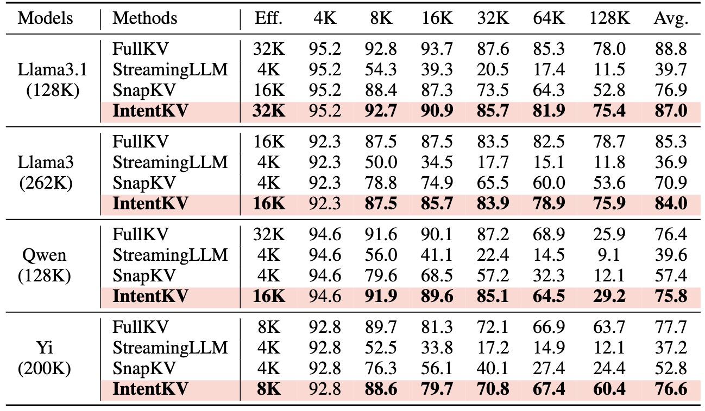
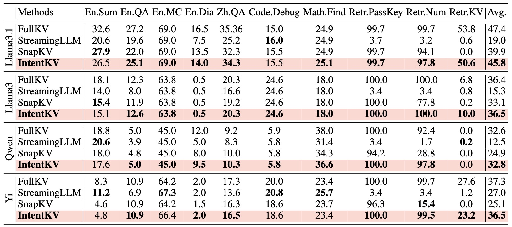

# IntentKV
This repository contains the implementation of IntentKV, a novel KV cache eviction/compression method introduced  in our paper:

**Question Tells You Where the Answer Is: Intention-aware KV Cache for Long-Context LLM Inference**

Liang Zhao, Xiaocheng Feng, Weihong Zhong, Lei Huang, kun Zhu, Baoxin Wang, Dayong Wu, Guoping Hu, Ting Liu, Bing Qin

ACL 2026
## Repository Structure
The repository contains three code bases under the following directories:

1. `intentkv`: This directory contains the core code of IntentKV as well as the interface `patch_model` to integrate IntentKV with Llama-like models (Mistral, Qwen, Yi, and so on).

2. `evaluation`: the evaluation code on different benchmarks to reproduce the results in our paper, each is adapted from the original repository. Besides, the code to evaluate the efficiency of IntentKV is given in this directory.
## Requirements
- Torch
- FlashAttention-2
- Transformers >= 4.46.0
## Installation
```
git clone git@github.com:linkezh/IntentKV.git
cd IntentKV
pip install -e .
```
## Integrate IntentKV with LLMs
The `llm` in the following code refers to `Transformers` model. Models except standard architecture (Llama, Qwen) may need customization.
### Generation
To integrate IntentKV with LLMs for generation, simply use `patch_model` as: 
```python
from intentkv import patch_model
patch_model(llm, config={"init_q_window": init_q_window, "max_capacity_prompt": max_capacity_prompt, "block_size": block_size})
```

### Forward
In some special cases, maybe the user intends to use IntentKV with `forward` function (instead of `generation`) of the model, which can be done by simply passing instance of `IntentKVCache` as `past_key_values` parameter of `forward` function:
```
from intentkv import IntentKVCache
past_key_values = IntentKVCache(config=config={"init_q_window": init_q_window, "max_capacity_prompt": max_capacity_prompt, "block_size": block_size})

with torch.no_grad():
    outputs = model(
        input_ids=input_ids,
        past_key_values=past_key_values,
        use_cache=True,
    )
```

A full example is presented in the [efficiency evaluation code](./evaluation/efficiency/benchmark_e2e_kv.py), where we have to use `forward` to benchmark the speed and memory usage of pre-filling and deocding.

## Evaluation
### InfiniteBnech
[InfiniteBench](!https://github.com/OpenBMB/InfiniteBench) is designed for evaluating the capabilities of language models to process, understand, and reason over super long contexts (100k+ tokens), comprising 12 unique tasks. Our evaluation involves `kv_retrieval`, `longbook_choice_eng`, `math_find`, `longbook_qa_chn`, `longbook_qa_eng`, `longdialogue_qa_eng`, `code_debug`, `longbook_sum_eng`, `number_string`, `passkey`.

To evaluate Llama-3.1-8B-Instruct with IntentKV, simply:
```
bash evaluation/infinite_bench/run.sh
```
The model and data path are both specified in the `run.sh` script, which you can modify to adapt to different settings.
### Ruler
The [Ruler](!https://github.com/NVIDIA/RULER/tree/main) is designed to evaluate the real context size of large language models by generating synthetic examples across 4 task categories (in total 13 tasks) with configurable sequence length and task complexity, evaluating long-context capabilities beyond simple in-context recall.

To run the RULER benchmark, you need first install the requirements:
```
pip install Cython
pip install nemo-toolkit[all]==1.21 --no-deps
pip install -r experiments/ruler/requirements.txt
```

1. download Paul Graham Essays as well as QA datasets for data generation:
```
cd scripts/data/synthetic/json/
python download_paulgraham_essay.py
bash download_qa_dataset.sh
```
If `punkt` in `nltk` is not downloaded:
```
python -c "import nltk; nltk.download('punkt')"
```
2. Run evaluation with IntentKV and Llama-3.1-8B-Instruct:
```
bash evaluation/ruler/run.sh
```
where all parameters are written in the script. E.g., you can modify `MODEL_FRAMEWORK` to `'hf'` to disable IntentKV.

### Partial Results
Results on Ruler


Results on InfiniteBench

## Citation
If you find IntentKV helpful or relevant with your research or project, please kindly cite our paper.