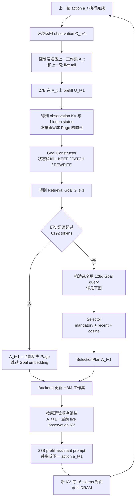
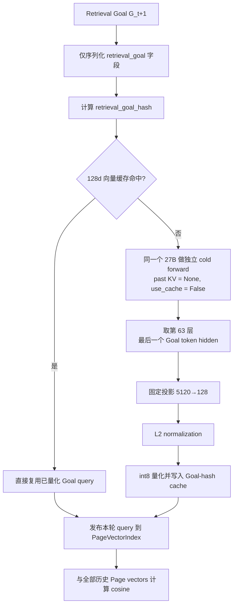

# DRAM-Backed KV Online Selector V2：代码架构与算法说明

> 状态：当前实现说明（`feature/prefill-page-selector-v2`，基线提交 `ca0ce27`）。

> 本文面向组会/教授讲解，描述当前 `feature/prefill-page-selector-v2` 分支的实际实现。重点是模块边界、每轮数据流、Goal 维护、向量构造和 Page 选择算法，不展开具体函数与代码细节。

## 1. 系统解决的问题

长轨迹 Agent 会不断积累历史 prompt 和 KV cache。系统把历史 KV 切成固定的 **16-token Page**，完整 Page 保存在 CPU DRAM；每轮只把当前最有价值的一部分 Page 恢复到 GPU HBM，作为主模型的活跃上下文。

当前系统支持三种可对照的运行模式：

| 模式 | 历史上下文 | 排序 query | 额外主模型 forward |
|---|---|---|---|
| Full Context | 保留全部历史 Page | 无 | 无 |
| Observation Query | 按预算选择 Page | 最新 observation 的 hidden state | 无，复用正常 prefill |
| Goal Query | 按预算选择 Page | 结构化 Retrieval Goal 的 hidden state | Goal 首次出现时有；相同 Goal 按 hash 复用 |

三种模式共享同一套 Page、DRAM Runtime、KV 恢复和逻辑位置机制，因此可以把质量、时延和显存占用的差别主要归因于是否选择以及 query 来源。

Full Context 模式会关闭 Goal Constructor、hidden-state hook、向量投影和 Selector，只保留完整 Page/KV 生命周期；两个 Selector 模式都会在线维护 Goal，但 Observation 模式的 Goal 不参与正常的余弦排序。

## 2. Goal 模式总体架构与每轮时序



Goal query 的内部路径单独展开如下：



当前实现采用一次 observation prefill 的复用时序：先在上一工作集 \(A_t\) 上处理 observation，再切换到新工作集 \(A_{t+1}\)。因此 observation KV 是 \(KV(O_{t+1}\mid A_t)\)，随后与 \(KV_{A_{t+1}}\) 一起服务 assistant prompt 和 generation。它避免了重复预填 observation，能够看见最新工具结果，也不会在工作集切换时丢失 live observation KV；代价是本轮新恢复的 Page 不会反向改变已经生成的 observation 表示。这是当前明确采用的工程折中，而不是 dense full-history prefill。

第一轮使用 cold prefill 建立初始逻辑轨迹；历史未超过 8192 tokens 时仍维护 Goal，但保留全部 Page，并跳过 Goal embedding 和 Selector 排序。

> **代码对应：** 常规 turn 的两阶段时序见 `scripts/serve_online_selector_v2.py:975–1036`；上一工作集准备见 `:749–779`；Goal query 发布与缓存见 `:552–634`。

## 3. 核心模块与边界

| 模块 | 输入 | 输出 | 职责边界 |
|---|---|---|---|
| Online Orchestrator | 对话消息、模型输出 | 每轮完整执行与日志 | 串联各模块，但不把选择策略写入 Runtime |
| Goal Constructor | `TurnContext` | `GoalRecord` | 维护检索意图，不选择 Page，不操作 KV |
| Page Vector Publisher / Index | 主模型 hidden state | 兼容的紧凑 Page/query 向量 | 管理向量空间、来源校验和不可变发布 |
| Selector | `TurnContext`、`GoalRecord`、`PageCatalog`、向量快照 | `SelectionPlan` | 只做纯选择；不运行模型，也不搬运 KV |
| Backend / Runtime | `SelectionPlan`、Page KV | 有序的活跃 KV Page | 执行 DRAM↔HBM 生命周期和传输统计，不理解 Goal |
| Qwen Forward Bridge | 有序 Page KV、逻辑位置 | 可供模型 prefill 的 cache | 保证物理 cache 连续，同时保留原始逻辑 RoPE 位置 |

这里的 **Online Orchestrator（在线控制层）** 不是额外模型，也不是一种排序算法。它是 online server 中由 `OnlineSelectorSession` 承担的会话级调度代码：解析 Mini-SWE-Agent 请求，维护逻辑 token、Page Catalog、live tail 和 Goal cache，并按顺序调用 Goal Constructor、Selector、Backend 和主模型。它负责“何时调用谁、把谁的输出交给谁”，具体 Goal 规则、Page 排序和 KV 搬运仍分别封装在独立模块中。

几个关键数据对象使模块保持解耦：

- `TurnContext`：当前 turn、根任务、最新 action/observation、历史 Page 和驻留状态。
- `GoalRecord`：冻结的 root goal、当前 Retrieval Goal、门控决定、触发原因、SLM 成本及 hash。
- `PageRecord/PageCatalog`：Page 的逻辑区间、turn、mandatory 标记、向量引用和 DRAM 元数据。
- `SelectionPlan`：最终 Page 顺序、保留原因、预算以及 active-set 的增删变化。

## 4. Goal Constructor

### 4.1 Goal 的语义

系统区分两个概念：

- **Root Goal** 是用户原始任务，会话内冻结，防止目标漂移。
- **Retrieval Goal** 是当前阶段“应该从历史中找什么证据”的结构化控制信号，不是给 Agent 的执行计划。

Retrieval Goal 包含简短描述、阶段、文件、符号、测试、错误、所需证据、状态和用户约束。只有这个结构化检索意图会被序列化成 Goal query；完整轨迹、诊断日志和 Constructor 元数据不会送进 Goal embedding。

### 4.2 每轮维护算法

1. **确定性特征提取**：只读取上一动作和最新 observation，提取 action 类型、return code、测试结果、diff、文件、符号、测试名、错误和栈帧。所有字段都有数量与长度上限。
2. **阶段跟踪**：在 exploration、hypothesis、implementation、verification、stuck 间更新。前进可以立即发生，回退使用迟滞和 cooldown，避免频繁抖动。
3. **Gate 判定**：根据可信的新证据选择 `KEEP`、`PATCH` 或 `REWRITE`。
4. **应用更新**：
   - `KEEP`：Goal 字节级保持不变；
   - `PATCH`：用规则增补实体、证据和状态，不调用 SLM；
   - `REWRITE`：调用常驻的 Qwen3-0.6B SLM 生成新的结构化 Goal，再做严格 schema 校验。
5. **失败回退**：SLM 启动、生成、JSON 解析或验证失败时，退回确定性 PATCH/KEEP，不让 Goal 子系统阻断主流程。

### 4.3 State 与工作集 Policy

State Detector 已经实现，并会为每个稳定 phase 生成 `GoalPolicyHint`：

| State | 建议 active budget | Slack | Diversity | Structure | 建议优先内容 |
|---|---:|---|---:|---:|---|
| exploration | 20k | high | 0.85 | 0.50 | task anchor、recent tail、多样历史 |
| hypothesis | 16k | medium | 0.50 | 0.90 | 诊断输出、stack trace、错误实体 |
| implementation | 12k | low | 0.20 | 0.95 | 编辑文件、符号、依赖邻居 |
| verification | 16k | medium | 0.20 | 0.65 | 测试结果、复现结论、修改记录 |
| stuck | 20k | high | 0.95 | 0.50 | 最近成功状态、失败尝试、任务锚点 |

但这组 policy **目前是 advisory metadata：已计算并写入 `GoalRecord`，尚未接入当前 online Selector**。当前实验继续使用固定参数来隔离 query 来源的影响：8192-token 切换阈值、超过阈值后 40% active ratio、最近 2 个 turns、最多 64 个 recent Pages；实际预算还会保证不少于 mandatory prefix。Phase-conditioned budget、slack retention、diversity 和 structure weighting 留作独立实验，避免与 Goal-vs-Observation 对照混杂。

### 4.4 Goal Gate

Gate 的主要优先级如下：

| 证据边界 | 决定 | 含义 |
|---|---|---|
| 用户新增明确要求 | REWRITE | 将可信约束纳入 Goal |
| 连续停滞 | PATCH | 增加恢复所需证据 |
| 连续实体失配 | REWRITE | 当前 Goal 可能已失效 |
| 新的确认错误或首个栈帧改变 | REWRITE | 原假设被运行证据否定 |
| 测试通过、阻塞解除或普通执行失败 | PATCH | 更新状态和证据需求 |
| 发现/扩展文件、符号、测试等实体 | PATCH | 补充检索锚点 |
| 没有可靠边界 | KEEP | 避免无意义地重写 Goal |

这里的“确认错误”必须来自非零结构化 return code、失败测试，或完整 traceback 形态。成功输出中仅出现 `TypeError`、`ValueError` 等源码字符串，不再触发错误门控。

> **代码对应：** State 阈值在 `src/dram_kv/goals/state.py:20–35`，phase 更新在 `:116–151`，phase 判定在 `:195–209`，stuck 判定在 `:214–228`；State→Policy 映射在 `src/dram_kv/goals/maintained.py:58–80`；Constructor 主入口在 `:140–154`，KEEP/PATCH/REWRITE Gate 在 `:468–511`，PATCH 规则在 `:513–559`。REWRITE 使用的模型是 Qwen3-0.6B，运行配置见 `scripts/run_online_selector_v2_swe_h200.sbatch:41–64`；SLM 的 system prompt 在 `scripts/qwen_goal_rewriter.py:174–197`，约束输出的 JSON schema 在 `:54–80`。

## 5. Page 与 Query 向量

### 5.1 共享向量空间

Page 和 query 必须使用完全相同的向量管线：

$$
v = Q_{int8}\left(\operatorname{L2Norm}(P h)\right)
$$

这里的 **pooling** 是把一段包含多个 token 的 hidden states \(H=[h_1,\ldots,h_L]\) 汇总成一个固定长度向量 \(h\) 的操作。当前使用 `last_token pooling`，即直接令 \(h=h_L\)，没有对 token 做平均。由于 causal Transformer 的 \(h_L\) 已经 attention 到它前面的 token，它可以作为整段内容的上下文化摘要。

随后各环节的作用是：

1. **深层 hidden state：** 当前 `hidden_layer=-1` 对 64 层模型解析为第 63 层，即最后一个 decoder block 的输出，使用主模型已经形成的上下文语义，而不是外部词法 embedding。
2. **固定投影 \(P\)：** 代码在初始化时用固定 seed 生成一个 \(128\times5120\) 的随机符号矩阵，元素为 \(\pm1/\sqrt{128}\)。计算 \(Ph\) 将 5120 维压到 128 维；它不训练、可复现，并在 query 与 Page 两侧完全共享，目标是低成本地近似保留向量夹角。
3. **L2 normalization：** 对投影结果 \(x\) 计算 \(x/\sqrt{\sum_jx_j^2}\)，把长度变为 1。这样排序只比较语义方向，不受 hidden magnitude 影响，点积也等价于 cosine。
4. **对称逐向量 int8 量化：** 令 `scale=max(abs(x))/127`，保存 \(q_j=round(x_j/scale)\in[-127,127]\) 和一个 scale。比较时可用 \(q_j\times scale\) 近似恢复浮点值；相对 FP32，128 维主体存储约缩小到四分之一。

这条管线的目的不是宣称随机投影或 last-token pooling 理论最优，而是得到一套**不需要训练、可从正常推理免费产生、存储和 cosine 计算都很轻量**的在线基线。Provenance 会绑定 model、layer、pooling、投影 hash、维度和量化参数，禁止比较来自不同向量空间的记录。

每个 Page 固定为 16 tokens，Page vector 取该 Page **最后一个 token** 的 hidden state。它不是词法 embedding，也不是额外 embedding 模型的输出，而是主模型在真实轨迹 prefill/decode 中产生的深层语义表示。

只要 Page 与 query 的 provenance 有任一项不兼容，整次决策就回退到确定性 lexical selector，避免混用不同向量空间。

### 5.2 Observation Query

正常预填最新 observation 时，系统直接取其最后一个 token 在第 63 层的 hidden state，再走同一投影管线。因此它表达“模型读完最新运行反馈后当前最关心什么”，且没有额外 27B forward。

“最后一个 token”只是读取汇总表示的位置，并不意味着 query 只包含最后一个词的信息：该位置已经通过 causal attention 聚合了前面的 observation 和当前活跃历史。其优点是与 16-token Page 的 last-token 表示对称、零额外 pooling 成本；风险是很长 observation 的结尾可能是固定模板或标记。当前跑通结果保留它作为基线，后续可单独比较 `mean_last_16`，但不在本轮改变定义。

### 5.3 Goal Query

Goal query 的构造为：

```text
当前轨迹
  → Goal Constructor 执行 KEEP / PATCH / REWRITE
  → 必要时由常驻 0.6B SLM 生成结构化 Retrieval Goal
  → 仅序列化 Retrieval Goal
  → 按 retrieval_goal_hash 查询会话内缓存
  → 缓存未命中时，单独送入同一个 27B 主模型
  → 取第 63 层最后一个 Goal token 的 hidden state
  → 与 Page 相同的固定投影、L2 归一化和 int8 量化
  → 得到 128 维 query
```

这个 Goal 文本不会追加到 Agent 可见 prompt，也不会保留它的 KV。相同 `retrieval_goal_hash` 直接复用已经量化的 128 维向量，不再 tokenize 或执行 27B Goal forward；SLM 是否运行由前面的 Goal Gate 独立决定，KEEP/PATCH 本身不调用 SLM。当前实现对序列化后的 Goal 没有单独设置 256-token 截断；它依靠字段数量、字段长度、description 字符数和 SLM 输出上限控制规模，并在日志中记录实际 token 数。

Goal forward 复用已经驻留的同一个 27B 模型权重，而不是再加载一份约 54 GB 的模型；它设置 `past_key_values=None`、`use_cache=False`，所以只增加短暂的 activation/workspace 和串行计算延迟，不保留 Goal KV。另一个常驻模型是独立的 Qwen3-0.6B SLM，BF16 权重约 1.2 GB（约 1.1 GiB），只在初始化或 REWRITE 时生成结构化 Goal。

> **代码对应：** 随机投影矩阵在 `scripts/serve_online_selector_v2.py:133–141`，投影、L2 和 int8 在 `:492–508`，Page boundary hidden 在 `:510–525`；Goal 序列化在 `:161–169`，Goal cache/27B forward 在 `:552–627`；紧凑向量及反量化在 `src/dram_kv/page_vectors.py:94–140`，Page/query 索引在 `:204–269`。

## 6. Selector 算法

Selector V2 的输入是已经发布好的 query 与 Page vectors。它不调用 Goal Constructor、SLM 或主模型，也不接触实际 KV tensor。

设本轮 query 为 \(q_t\)，历史 Page \(i\) 的向量为 \(v_i\)，语义分数为：

$$
s_i = \cos(q_t, v_i)
$$

选择过程分三层：

1. **Mandatory Pages**：系统 prompt 与原始任务所在的稳定前缀始终保留；它是硬约束。
2. **Recent Safety Pages**：从最近若干 turn 中按“越新越优先”保留限定数量，防止纯相似度漏掉刚发生的局部状态。
3. **Semantic Retrieval Pages**：其余 Page 按余弦分数降序填满预算；同分时用逻辑位置和 Page ID 确定性打破平局。

最终集合会重新按原始逻辑位置排序，而不是按相似度顺序拼接，从而保持 Transformer 看到的时间顺序。`SelectionPlan` 同时记录每个 Page 是 mandatory、recent 还是 cosine 命中，以及与上一工作集相比 added、retained、removed 的变化。

当前默认在历史未超过 8192 tokens 时保留全部 Page；超过阈值后，活跃 token 预算约为历史的 40%，但绝不会低于 mandatory Page 的总量。主实验使用纯 embedding cosine；代码中的 lexical/hybrid selector 不属于当前 Goal-vs-Observation 对照，只在向量失效时 lexical fallback 会参与。

> **代码对应：** 向量完整性和 provenance 检查在 `src/dram_kv/selectors/prefill_v2.py:190–219`，mandatory/recent partition 在 `:221–256`，cosine、排序和 SelectionPlan 构造在 `:317–414`；online 阈值和预算接线在 `scripts/serve_online_selector_v2.py:711–747`。

## 7. Backend、Runtime 与逻辑位置

`SelectionPlan` 生成后，Backend 同步完成所选 Page 的恢复：已在 HBM 的 Page 直接复用，不在 HBM 的 Page 从 DRAM 搬回，未被选中的 Page 从活跃集合释放。所有传输成功后才一次性提交新状态，避免出现半完成工作集。

随后 Qwen Forward Bridge 按 Page 原始逻辑顺序组装 KV。模型的物理 cache position 仍然连续，用于 causal mask；单独传入的 logical position 用于 RoPE，因此即使中间 Page 被裁掉，保留 Page 仍使用它在完整轨迹中的原始位置。这一层把 Selector 的逻辑决定与具体 Qwen cache 实现隔离开。

生成结束后，新产生的 KV 每满 16 tokens 就封成不可变 Page，同时写入 DRAM，并可暂时保留在 HBM 供下一 observation 使用。

### 7.1 当前原型中的底层表

当前实现是独立 PyTorch 原型，不是 vLLM Block Manager，因此还没有固定 GPU block pool 或显式 `slot_mapping`。现有数据结构共同承担了逻辑页表、位置映射和驻留目录的作用：

| 表/结构 | Key | Value / 作用 |
|---|---|---|
| `PageCatalog` | `page_id` | token span、原始 logical positions、turn、mandatory、vector ref |
| `PageVectorIndex.pages` | `(session_id, page_id)` | 128 维 Page vector 与 provenance |
| `PageVectorIndex.queries` | `(session_id, turn_id)` | 本轮 128 维 query |
| Runtime `dram` | `page_id` | CPU pinned `QwenKVPage`，即各 full-attention 层的 K/V |
| Runtime `resident` | `page_id` | 当前驻留 GPU 的 `QwenKVPage` |
| Runtime `ever_resident` | `page_id` 集合 | 区分首次 restore 与 reactivation |
| Backend `PreparedTurn` | `session_id` | turn、plan capability hash、有序 GPU payloads，防止使用过期 plan |
| `active_logical_positions` | dense physical offset | 该物理位置对应的原始逻辑 token/RoPE 位置 |

它们的联动过程是：

```text
SelectionPlan.ordered_page_ids
  → resident 命中则复用，否则从 dram 做 H2D restore
  → 从 resident 中释放本轮落选 Page
  → 按原始 logical position 排列所选 QwenKVPage
  → 对每个 full-attention layer 沿 token 维拼接 K/V
  → 写入连续的 Qwen physical cache
  → 用 active_logical_positions 保留原始 RoPE 位置
```

当前每轮通过拼接得到连续 tensor，因此一个 token 的“slot”可理解为“所选 Page 在有序工作集中的序号 × 16 + Page 内 offset”；它不是长期固定的物理块号。未来接入 vLLM 时才会显式形成 `logical page_id → DRAM address → GPU block_id → slot_mapping[token]`，并通过共享 block pool 真正回收 GPU blocks。当前 `torch.cat` 还可能带来瞬时双份 tensor，删除 Python resident 引用也不等同于立即释放 PyTorch CUDA allocator 的 reserved memory。

> **代码对应：** Runtime session 内的 DRAM/resident 表在 `src/dram_kv/runtime/core.py:59–85`，事务式 reuse/restore/release 在 `:180–258`；Backend 的 `PreparedTurn` 在 `src/dram_kv/backends/dram.py:17–68`；`QwenKVPage` 结构在 `src/dram_kv/runtime/qwen.py:15–49`，Page 拼接和 cache 写入在 `:170–247`；physical/logical position 分离在 `src/dram_kv/runtime/qwen_forward.py:32–89` 和 `:218–248`。

## 8. 可审计性与当前限制

每轮日志能够回答四类问题：

- Goal 为什么 KEEP/PATCH/REWRITE，哪些字段改变；
- SLM 是否启动/生成、输入输出 token 数及各阶段耗时；
- Goal query 的字符/token 数、cache hit、tokenize、27B forward、投影与发布耗时；
- Selector 选择了哪些 Page，以及 DRAM↔HBM 的字节数、复用数、恢复数和耗时。

当前仍需关注两个实验性限制：第一，较长 Retrieval Goal 目前只有结构字段级边界，没有统一的 256-token 硬上限；第二，连续实体失配可能让 `goal_invalid` 在后续 turn 再次触发，应继续用 gate 日志检查 Goal 重写后漂移计数是否合理。

## 9. 一句话总结

这套系统把“**当前需要找什么**”（Goal Constructor）、“**哪段历史最相关**”（Selector）和“**如何真正恢复 KV**”（Runtime/Backend）拆成独立模块；Observation query 用零额外 forward 的最新模型状态做检索，Goal query 用可缓存的结构化长期意图做检索，而 Full Context 提供不做选择的质量与成本基线。
